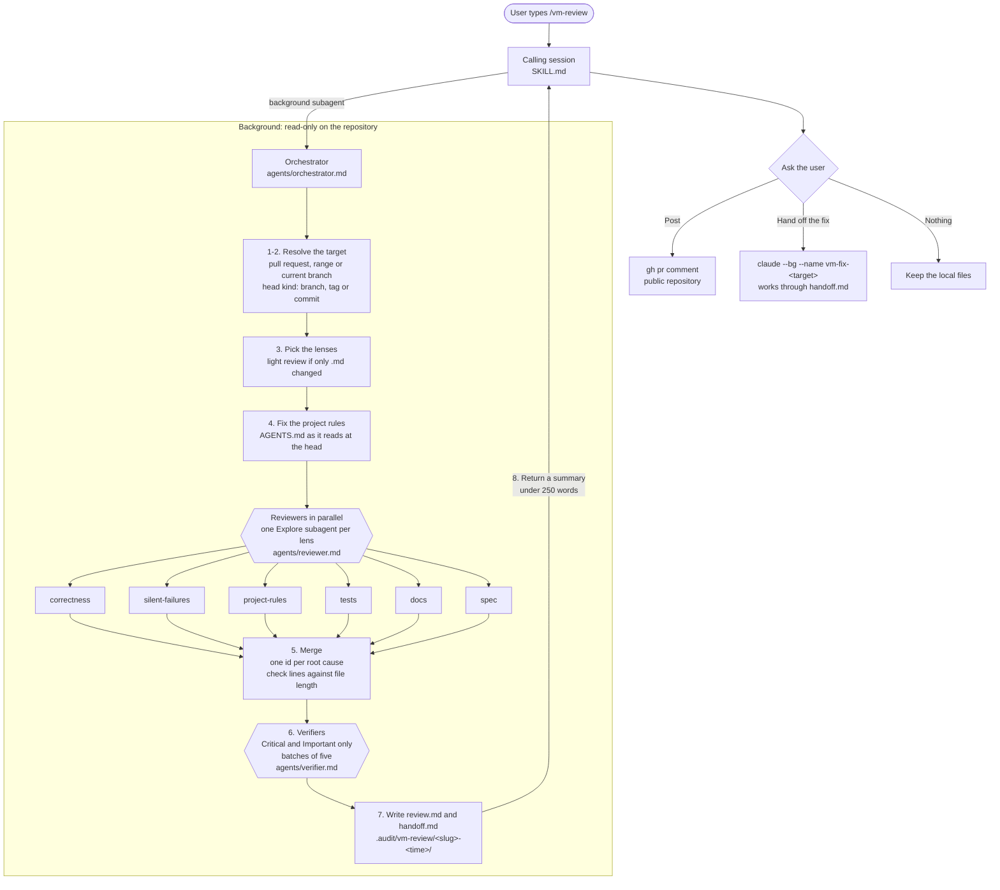

# vm-review: how it works

For developers who want to understand or change the skill. Claude reads `SKILL.md` and the files
under `agents/`; this file is only for people.

`/vm-review [<pr-number>|<range>] [--lenses a,b] [--spec <path>] [--full]` reviews a pull request,
a git range or the current branch. The session you type it in never reads the diff: it starts an
orchestrator in the background, and only a short summary comes back.

## Flow

## What each step guards against

| Step | Rule | Why |
|---|---|---|
| Calling session | Only launches and relays | Diffs and file dumps would fill the session the user keeps working in |
| Orchestrator | Writes only under `.audit/vm-review/`, never posts | A review that changes the tree, or publishes on its own, cannot be trusted |
| Reviewers | `Explore` subagents | That agent type cannot edit files, so read-only holds by construction |
| Project rules | One copy of `AGENTS.md` at the head, passed to every subagent | The session loads the working tree's rules, which may be newer than the reviewed code |
| Lens models | `opus` for correctness and silent failures, `sonnet` for the rest | Those two find the bugs that cost most when missed |
| Verifiers | At most five findings each, try to refute them | Reviewers still produce confident false positives |
| Line check | Lines past the end of the file are flagged | Reviewers sometimes cite a position in the diff output |
| Handoff | Names only tools and paths that exist at the head | The fixer starts from the head, not from this working tree |

## Files

| Path | Role |
|---|---|
| `SKILL.md` | What the calling session does: launch, relay, ask, post or hand off |
| `agents/orchestrator.md` | Steps 1 to 8 of the flow above |
| `agents/reviewer.md` | Contract for every lens reviewer: read-only, finding format |
| `agents/verifier.md` | How a verifier tries to refute a finding |
| `references/lenses/*.md` | One checklist per lens |
| `assets/*-template.md` | Skeletons of `review.md` and `handoff.md` |
| `evals/` | Test cases and graders; see `evals/README.md` |

## Changing the skill

1. Edit the file of the step you are changing; keep the reason for a rule next to the rule.
2. Run the evals (`evals/README.md`): one run per case with and without the skill, graded and
   compared with the previous iteration. The `eval/*` tags they review are on GitHub. Name the
   session `vm-eval-it<N>`.
3. When an eval shows a new kind of mistake, add a grader for it, so the next iteration measures it.
