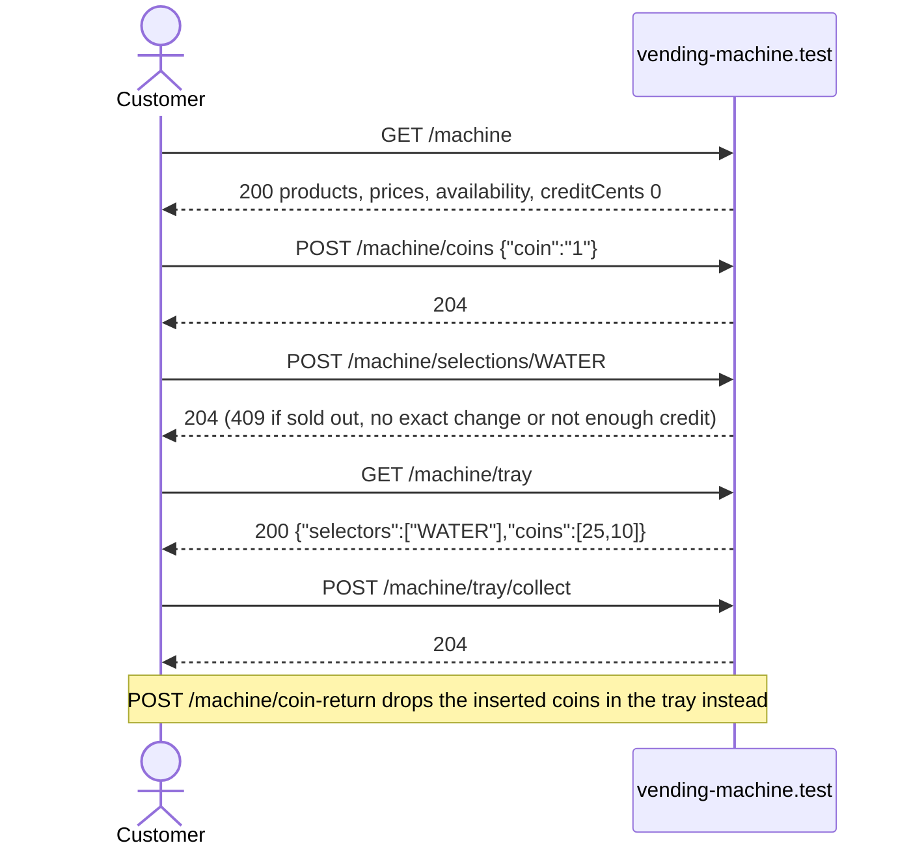
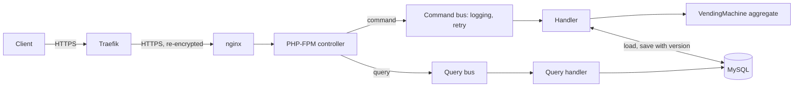

# Vending machine

A vending machine modelled in PHP: it accepts coins (0.05, 0.10, 0.25 and 1), sells products
(Water 0.65, Juice 1.00, Soda 1.50), gives change, returns the inserted coins on request and lets
a technician service it by setting the available change and the stock of each product.

Work in progress: the project is being built in small pull requests, infrastructure first.

## Stack

- PHP 8.5 (FPM, with Xdebug) and Symfony 8.1
- MySQL 8.4
- MongoDB 9.0, in an optional compose profile (see below)
- nginx behind Traefik 3.7, HTTPS end to end
- PHPUnit 13, PHPStan 2 (max level), deptrac, php-cs-fixer

Everything runs in Docker: the host needs no PHP, Composer or MySQL.

## Requirements

- Docker Engine with Compose v2 (`docker compose`)
- GNU make
- [mkcert](https://github.com/FiloSottile/mkcert#installation), for the local HTTPS certificate
- `sudo` rights, once, to add the hostname to `/etc/hosts` and trust the mkcert authority
- Free ports on localhost: 80, 443, 8080 (Traefik dashboard), 3307 (MySQL) and 27018 (MongoDB).
  They can be changed in `.env`.

## First run

```bash
make first-run
```

It creates `.env` from `.env.dist`, writes your user and group ids into it, prepares the host (see
below), builds and starts the containers, installs the Composer dependencies, runs the database
migrations and enables the git hooks. Then:

```bash
curl https://vending-machine.test/health-check
# {"status":"ok","checks":{"database":"ok"}}
make run -- app:health-check
# {"status":"ok","checks":{"database":"ok"}}
```

The same use case has two entry points: the controllers behind `/health-check` and
`/health-check/ready` and the `app:health-check` console command all send a `HealthCheckQuery` to
the query bus. The answer reports the application, which is `ok` whenever it answers, and each of
its dependencies, `ok` or `ko`, under `checks`. A `ko` database logs a warning with the reason it
did not answer.

- Liveness: `/health-check` answers 200 and `app:health-check` exits 0 even when a dependency is
  `ko`, so a database that does not answer never marks the application itself as down.
- Readiness: `/health-check/ready` answers 503 and `app:health-check --ready` exits 1 when any
  dependency is `ko`, so a Docker healthcheck can wait for the database.

Afterwards `make start` and `make stop` are enough. `make help` lists every target, and
`make run -- <command> <options>` runs a Symfony console command, for example
`make run -- debug:router --format json`. The `--` keeps make from reading the options as its own.
Give an option its value after a space: make takes a word with `=` (`--format=json`) as a variable
and drops it.

A checkout from before HTTPS was added needs `make setup-host` once: `make start` stops with a
message until the certificate files exist in `etc/infrastructure/certs/`. A checkout from before the
database was used needs the `DATABASE_URL` line of `.env.dist` copied into its `.env`, then
`make migrate`, which creates the tables in the dev and test databases (run it again after pulling a
new migration).

| Service | Where |
|---|---|
| Web | <https://vending-machine.test> |
| Traefik dashboard | <http://127.0.0.1:8080> |
| MySQL | `127.0.0.1:3307`, databases `app` and `app_test`, user `app` and password `app` as set in `.env` (`make db-shell`) |
| MongoDB (profile `mongo`) | `127.0.0.1:27018`, database `app`, user `root` and password `root` as set in `.env` |

All ports bind to localhost only. The PHP container runs as your user, so files it writes through
the bind mount stay yours.

### MongoDB

MongoDB will hold the vending machine aggregate and its outbox, while MySQL keeps the technicians
and the history. Its repository adapter is not written yet, so the `mongo` service sits in the
compose profile `mongo` and `make start` does not start it. Start it on demand:

```bash
docker compose --profile mongo up -d mongo
```

`make stop` and `make down` leave it alone, since they do not enable the profile: stop it with
`docker compose --profile mongo stop mongo`. Its data lives in the `mongo-data` volume. Copy the
`MONGO_*` variables from `.env.dist` into an existing `.env`.

`make start` builds the PHP image with the `mongodb` extension, installed through PECL like
Xdebug, so the first start after pulling this change takes a few minutes longer.

## Using the machine from the console

`vending:run` takes a sequence of actions separated by commas, runs them on the machine and prints
what drops into the tray: the products first, then the coins from the largest. The statement's
examples, from the default machine:

```bash
make run -- vending:reset
make run -- vending:run "1, 0.25, 0.25, GET-SODA"
# SODA
make run -- vending:run "0.10, 0.10, RETURN-COIN"
# 0.10, 0.10
make run -- vending:run "1, GET-WATER"
# WATER, 0.25, 0.10
```

The actions are a coin (`0.05`, `0.10`, `0.25` or `1`), `GET-<SELECTOR>` (`GET-WATER`,
`GET-JUICE`, `GET-SODA`) and `RETURN-COIN`. The machine rejects any other coin, as a real one
spits out a foreign coin, and a refused action (sold out, not enough credit, no exact change, an
unknown selector) keeps the credit: both are reported on the error output and the sequence goes
on.

Without a sequence, `make run -- vending:run` opens an interactive session: it lists the products,
takes one action per line, prints what drops into the tray after each one and shows the credit
in the prompt. `SERVICE` asks the units of each product and the count of each coin (Enter keeps
the current value) and services the machine. `QUIT` or Ctrl+D ends the session; Ctrl+D in the
middle of `SERVICE` leaves the machine as it was.

`vending:service` services the machine outside a session. `--units SELECTOR:UNITS` and
`--coins COIN:COUNT` give the new values, each repeated as needed, and it asks the rest with the
current values as defaults; with `-n` it keeps the current value of what the options leave out.
Servicing returns the credit left in the machine, so it first prints those coins as `vending:run`
prints the tray:

```bash
make run -- vending:service --units WATER:20 --coins 0.25:15 --coins 1:0 -n
# The machine is serviced.
```

Both `SERVICE` and `vending:service` read the current values once, before asking, and set every
value, the kept ones included. A sale that another session saves in between is therefore undone
by the service: service the machine while nobody else is using it.

The session needs interactive input: with `-n` or `-q` and no sequence the command reports it and
exits with 1, the only case besides an unexpected error where it does not exit with 0.
`vending:service` exits with 0 once the machine is serviced and with 1 whenever it is not, since
then the technician's service did not happen: an option it cannot read (not a pair, given twice, a
foreign coin, or a selector the machine lacks, which it checks before asking anything), input that
ends before the last answer, or a service the machine refuses.

The machine is stored in MySQL, so each run carries on where the last one left it: the stock and
the change go down as sales are made. Until a machine is stored, and after `vending:reset`, it is
the default machine in `config/services.yaml` (the statement's products, ten units of each and ten
coins of 0.05, 0.10 and 0.25 for change). The default is read only while no machine is stored: a
stored machine wins over a change to `vending_machine.default_products` until `vending:reset`
removes it. Credit left at the end of a sequence stays in the machine
until `RETURN-COIN` gives it back, as on a real one, also from a later run.

Change is made only from coins of 0.05, 0.10 and 0.25. Coins of 1, inserted by a customer or
stocked through `SERVICE`, stay in the machine as takings, as in a cash box, and are never given
as change; `SERVICE` asks their count on purpose, so the technician can empty the cash box.

## Using the machine over HTTP

The customer's side of the machine is a JSON API. Commands answer `204 No Content` with no body:
what they did is read with a query, such as the tray after a purchase.

| Request | What it does | Answer |
|---|---|---|
| `GET /machine` | The products (selector, name, price in cents, whether one is left) and the credit in cents | `200` |
| `POST /machine/coins` with `{"coin": "0.25"}` | Inserts a coin, written as in the statement: `0.05`, `0.10`, `0.25` or `1` | `204` |
| `POST /machine/selections/{selector}` | Sells the product: it drops into the tray with the change | `204` |
| `POST /machine/coin-return` | Drops the credit into the tray as coins | `204` |
| `GET /machine/tray` | The selectors of the products in the tray and the cents of each coin, from the largest | `200` |
| `POST /machine/tray/collect` | Empties the tray | `204` |

A customer who buys a water with a coin of 1, the statement's last example (`1, GET-WATER`), reads
the products, inserts the coin, selects the water, finds it in the tray with the change and
collects it:



The same purchase with curl:

```bash
curl -X POST https://vending-machine.test/machine/coins -H 'Content-Type: application/json' -d '{"coin": "1"}'
curl -X POST https://vending-machine.test/machine/selections/WATER
curl https://vending-machine.test/machine/tray
# {"selectors":["WATER"],"coins":[25,10]}
```

A refused request answers with its reason, `{"error": {"code": 409, "message": "..."}}`: `404` for
an unknown selector; `409` when the credit does not pay the product, it is sold out or the machine
has no exact change; `422` for a foreign coin, a body without a coin as a string or a malformed
selector. Servicing the machine stays in the console until technicians can log in.

[`docs/openapi.yaml`](docs/openapi.yaml) describes every route, with its bodies, the statuses it
answers and an example of each. It is written by hand, so it needs no bundle or attributes in the
code, and `tests/Integration/Shared/Infrastructure/OpenApiDocumentTest.php` fails when a route is
missing from it, a documented route does not exist, or a status the exception listener maps is
documented nowhere. To read it, open the file in PhpStorm (it renders OpenAPI files) or paste it into
an online viewer such as [Swagger Editor](https://editor.swagger.io).

The API and the console use the same machine, stored in MySQL: credit inserted over HTTP is credit
that `vending:run` sees, and the other way round. Start from `make run -- vending:reset` to get the
answers above. The functional tests play the statement's three examples through the API, each from
the default machine
(`tests/Integration/VendingMachine/Infrastructure/Controller/StatementExamplesTest.php`).

Each request reaches a controller through Traefik and nginx (see
[How a request travels](#how-a-request-travels)). The controller sends a command or a query to its
bus: a command goes through the logging and retry middleware to its handler, which loads the
machine, asks the aggregate to act and saves it with its version; a query is answered from MySQL.



## Logs

The command bus logs every command with its name and data: at info when it is handled, at notice
when the domain refuses it and at error when it fails for any other reason. A command that
implements `SensitiveCommand` lists the fields it carries that must not be logged as they are,
each with a `Masking` rule: `Hide` logs a secret such as a password or a token as `***`, and
`KeepFirstThree` logs personal data such as a technician's email with its first three characters
and `***` (`pau***`), so the log still tells who acted; a value of three characters or fewer is
hidden whole. A rule for a field that is not a public property of the command stops its dispatch
with a `LogicException`, so a misspelt or renamed field is never logged in clear. Each retry after
a concurrent update is logged
at notice with the same name and data, and so is each coin or action that `vending:run` rejects.
The change computed for a sale is logged at info, and a sale refused for want of exact change at
notice, by `LoggingChangeMaker`: a decorator in Infrastructure, so the domain's `ChangeMaker` needs
no logger. It logs when the change is computed, before the sale is saved, so a retried sale logs it
once per attempt. Symfony logs the exception behind a refused HTTP request (a domain exception or a
foreign coin) at info, not as a critical error, since nothing failed.

In dev the application's own logs go to a file a day, `var/log/dev-<YYYY-MM-DD>.log`
(`tail -f var/log/dev-$(date +%F).log`), of which the last seven are kept, and only its warnings
and errors also reach stderr, so the console shows the machine's output and its refusals
alone. Symfony's own logs go to stderr as JSON, all but the noisy `event`, `messenger`, `console`
and `doctrine` channels. In prod the application's logs and Symfony's go to stderr as JSON from
info up (`make logs php-fpm`), all but the `event`, `messenger` and `deprecation` channels.

## What the setup changes on your machine

`make setup-host` (part of `make first-run`) does two things, both idempotent:

1. `etc/infrastructure/setup-hostname.sh` appends one line to `/etc/hosts` (asks for sudo):

   ```
   127.0.0.1 vending-machine.test
   ```

   `.test` is a top-level domain reserved for testing, so it never clashes with a real site.

2. `etc/infrastructure/setup-ssl.sh` runs `mkcert -install`, which creates a local certificate
   authority on your machine and adds it to the system and browser trust stores, then issues a
   certificate for `vending-machine.test`, `*.vending-machine.test` and `nginx`. The certificate,
   its key and a copy of the authority's public certificate go to `etc/infrastructure/certs/`, which
   git ignores.

To undo both: remove the line from `/etc/hosts`, and run `mkcert -uninstall` (only if no other
project of yours uses mkcert).

## How a request travels

```
client --HTTPS--> Traefik --HTTPS--> nginx --FastCGI--> php-fpm (Symfony)
```

Traefik terminates TLS with the mkcert certificate, redirects HTTP to HTTPS and logs every request
(`make logs traefik`). It then opens a new TLS connection to nginx and verifies nginx's certificate
against the mkcert authority, so traffic is encrypted inside the Docker network too. Traefik finds
nginx through its Docker labels, which is why it mounts the Docker socket read-only. Symfony trusts
the proxies in the private address ranges (`TRUSTED_PROXIES`), so it sees the original scheme and
client address. Errors always come back as JSON: `{"error": {"code": 404, "message": "..."}}`.

## Quality checks

| Command | What it does |
|---|---|
| `make test` | Unit and integration tests (`make test -- --testsuite unit` for one suite) |
| `make coverage` | The tests with an HTML coverage report in `var/coverage` |
| `make phpstan` | Static analysis at the max level, with the Symfony and PHPUnit extensions |
| `make deptrac` | Per bounded context: Domain depends only on shared Domain, Application only on Domain and shared code, only Infrastructure uses the framework, no context reaches into another, and every class belongs to a layer |
| `make cs-fixer` | Fixes the coding standard |
| `make code-check` | The tests, PHPStan, deptrac and the coding standard in check mode (no coverage) |

`make hooks` (part of `make first-run`) points git at `etc/git/hooks-docker`. The hooks run inside
the PHP image, so the host needs no PHP: `pre-commit` checks the branch name and, when code,
configuration or tooling is staged, runs the coding standard, a container lint, PHPStan, deptrac and
the tests. The hooks join the containers' network when it exists, so the tests that use MySQL need
the containers started (`make start`). The checks read the files on disk, so `pre-commit` refuses a commit whose checked files
also have unstaged changes: stage them too, or set those changes aside first. When a Claude Code
skill or `AGENTS.md` is staged, it first checks the skills (`.claude/scripts/skill-check.sh`),
with the same refusal. `commit-msg` accepts
[Conventional Commits](https://www.conventionalcommits.org/), plus git's own merge, revert, fixup,
squash and amend messages. `post-checkout` runs `composer install` in a checkout without `vendor/`,
such as a new git worktree.

## Debugging with PhpStorm

Xdebug is installed in the PHP image. `.env` enables it with `XDEBUG_MODE=develop,debug,coverage`
and `start_with_request=yes`, so every PHP process tries to reach the IDE on port 9003. Set
`XDEBUG_MODE=off` in `.env`, or start with `XDEBUG_MODE=off make start`, when you do not need it.

1. Settings > PHP > Servers: add a server named `vending-machine.test`, host `vending-machine.test`,
   port 443, and map the project root to `/var/www`. The container sends that name through
   `PHP_IDE_CONFIG`.
2. Listen for debug connections (port 9003, the default).
3. Set a breakpoint and send a request, or run a console command with `make run-debug -- <command> <options>`.
   `make run-debug -- app:health-check` steps through the project's own code from the CLI: put the
   breakpoint in `HealthCheckQueryHandler`.

## Trying the API with Postman

`etc/postman/` holds a collection with every endpoint, one folder per bounded context, and an
environment that points `baseUrl` at `https://vending-machine.test`.

1. Import both files (File > Import).
2. Settings > Certificates: turn on CA certificates and select `etc/infrastructure/certs/rootCA.pem`,
   so Postman trusts the mkcert certificate.
3. Select the `vending-machine.test` environment and send a request, or run the whole collection.

The `VendingMachine` folder plays the statement's last example, `1, GET-WATER`, and checks the
machine after each step: the credit, the water with 0.25 and 0.10 in the tray, and the empty tray
once collected. Run it in order from a machine with no credit and an empty tray, as
`make run -- vending:reset` leaves it. A run leaves the machine that way again, with one water and
its change fewer, so the folder passes again until the water or the change runs out.

The repository is the source of the collection: after changing it in Postman, export it (v2.1)
over the file in `etc/postman/`. If you change `TRAEFIK_HTTPS_PORT` in `.env`, add the port to
`baseUrl`.

## Project layout

The code is split by bounded context first and by layer second:

```
src/
  Kernel.php
  Shared/            Shared kernel: small, stable, used by every context, uses none.
    Domain/          Money and DomainException, the base of every domain exception.
    Application/     The Command and Query interfaces, the bus ports, the health check query.
    Infrastructure/  Messenger buses, BaseController, JSON errors, health check entry points.
  VendingMachine/    The machine of the statement.
    Domain/          Business rules. Plain PHP.
    Application/     Use cases: commands, queries and their handlers.
    Infrastructure/  Symfony, controllers, console commands, persistence.
config/              Symfony configuration; routes in config/routes/<context>.php.
tests/Unit/          Unit tests, mirroring src/ (tests/Unit/<Context>/...).
tests/Integration/   Tests that boot the kernel (tests/Integration/<Context>/...).
etc/infrastructure   Docker images and the host setup scripts.
etc/git              Git hooks.
etc/postman          Postman collection and environment.
docs/                The OpenAPI document of the HTTP API.
```

A second context, `Maintenance` (technicians and their login), will arrive with technician
authentication. Folders exist only once they hold code.

deptrac checks the rules between layers and contexts:

- Domain depends only on `Shared/Domain`.
- Application depends only on its own Domain, `Shared/Domain` and `Shared/Application`.
- Only Infrastructure uses the framework (Symfony, Doctrine, PSR).
- Every context may use `Shared`; `Shared` uses no context; a context never uses another
  context's Domain.
- Every class in `src/` belongs to a layer, and every dependency points to a layer: a class of an
  undeclared context, or a library outside the `Framework` layer, fails the check.

Commands and queries go through two synchronous Messenger buses, behind the `CommandBus` and
`QueryBus` ports of `Shared/Application/Bus`. Command and query handlers of every context are
registered on `command.bus` and `query.bus` by their `CommandHandler` and `QueryHandler` suffixes
in `config/services.yaml`, so the Application layer needs no framework attributes.

The machine is saved with optimistic locking: its row has a version, and a save that finds another
version than the one it loaded fails with a `ConcurrentUpdateException`. The command bus then runs
the command again on the fresh machine, up to three more times, before it gives up.

### Adding a bounded context

1. Create `src/<Context>/` with the layers that have code, and its tests under
   `tests/Unit/<Context>/` and `tests/Integration/<Context>/`.
2. Add `<Context>Domain`, `<Context>Application` and `<Context>Infrastructure` layers and their
   rules to `deptrac.yaml`, following the `VendingMachine` entries. Until then `make deptrac`
   fails and lists the context's classes as unassigned.
3. Put its routes in `config/routes/<context>.php`; the kernel imports every file in that folder.
4. `config/services.yaml` needs nothing: its globs
   (`src/*/Application/Command/**/*CommandHandler.php`,
   `src/*/Application/Query/**/*QueryHandler.php` and the matching exclusions) already cover any
   context.

### Conventions

`AGENTS.md` holds the conventions for anyone working on the code, human or agent; `CLAUDE.md`
imports it.
