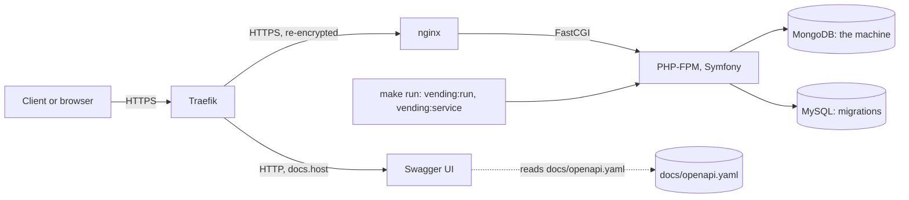
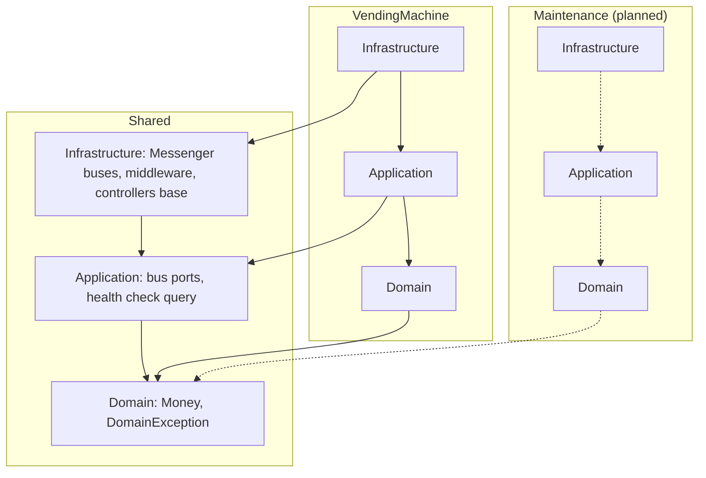
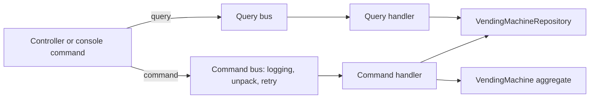
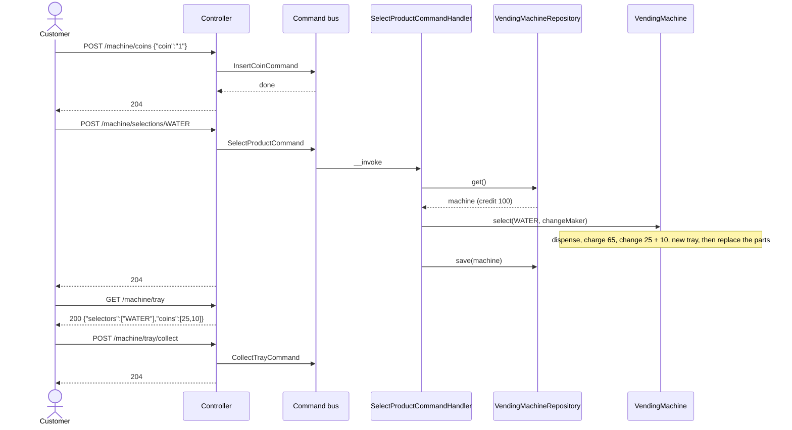
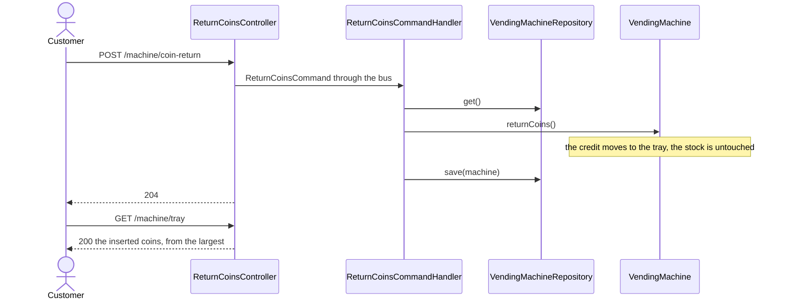
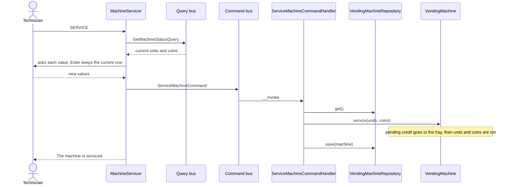
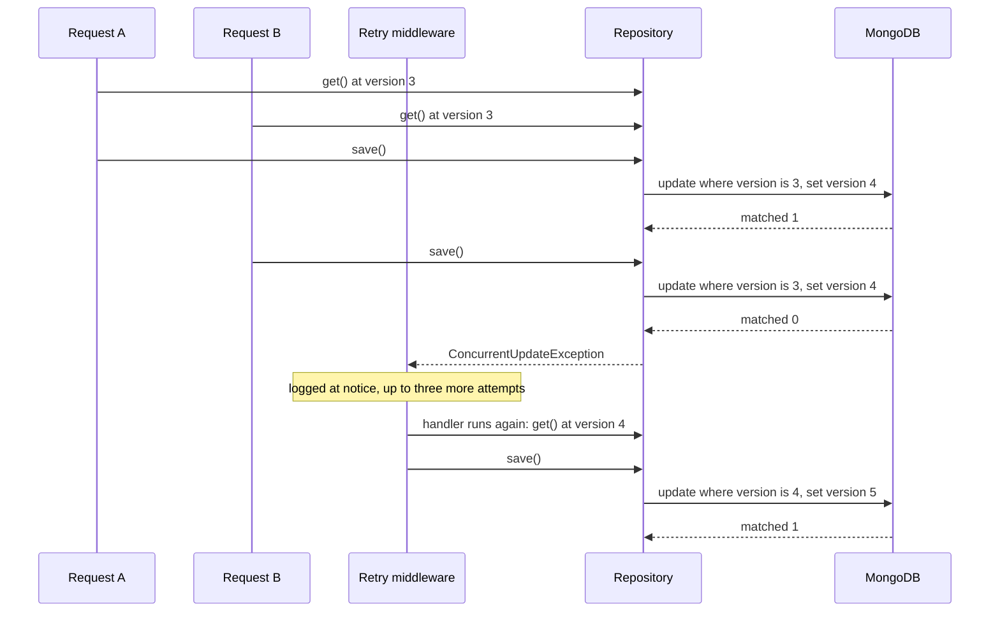

# Design

How the vending machine is built and why, in about ten minutes. It describes what is on `master`.
The decisions behind it are one short record each in [docs/adr](adr/README.md); this document links
them where they matter. How to run the project is in the [README](../README.md).

## 1. Context and problem

A vending machine, in our own words:

- It accepts coins of 0.05, 0.10, 0.25 and 1. Any other coin is rejected.
- It sells products, each with a selector and a price. The default machine sells Water (0.65),
  Juice (1.00) and Soda (1.50).
- A customer inserts coins, which become credit, and selects a product. If the credit covers the
  price, the product and the change drop into the tray, and the customer collects them.
- `RETURN-COIN` gives back the coins inserted so far.
- `SERVICE` is for a technician: it sets the units of each product and the count of each coin the
  machine holds.
- Change is given with the coins the machine holds, which are finite. If no combination of them
  adds up, the sale is refused and the credit stays.

The three examples of the statement, as `vending:run` prints them from the default machine:

| Actions | Output |
|---|---|
| `1, 0.25, 0.25, GET-SODA` | `SODA` |
| `0.10, 0.10, RETURN-COIN` | `0.10, 0.10` |
| `1, GET-WATER` | `WATER, 0.25, 0.10` |

The problem is small. The point of the design is to show how it would grow: new entry points, a
second storage engine, technician login, and several machines, without rewriting the rules.

## 2. Goals and non-goals

Goals:

- One machine and one customer at a time, as a physical machine works. The credit is state of the
  machine, not of a session ([ADR 11](adr/0011-one-customer-and-optimistic-locking.md)).
- Two entry points, the console and an HTTP API, over one core. Neither holds a business rule.
- Technicians authenticated for service and status. The customer side is public.
- A domain that is plain PHP, tested without a framework or a database.
- Checks that fail the build when the architecture is broken (deptrac, PHPStan at max level, a test
  that compares the OpenAPI document with the routes).

Non-goals, for now:

- Fleets of machines: there is exactly one, stored with id 1.
- Card payments or any payment other than coins.
- Domain events and the sales history built on them: planned, see [section 11](#11-future-work).

## 3. Architecture

### Containers

Everything runs in Docker. Traefik terminates TLS and opens a new TLS connection to nginx, so
traffic is encrypted inside the Docker network too
([ADR 15](adr/0015-https-with-traefik.md)). Swagger UI is static, so Traefik reaches it over plain
HTTP. The console is not a server: it runs inside the PHP container through `make run`.

### Bounded contexts and layers

`src/` is split by bounded context first and by layer second
([ADR 1](adr/0001-bounded-contexts-and-shared-kernel.md)). `Shared` is a small kernel that every
context may use and that uses no context. `Maintenance` does not exist yet, and its place is
reserved.

Arrows read "may use". deptrac enforces them in `make deptrac`, which also fails when a class
belongs to no layer or a dependency points outside every layer:

- Domain uses only `Shared/Domain`. It has no Symfony, no Doctrine and no attributes.
- Application uses its own Domain, `Shared/Domain` and `Shared/Application`.
- Only Infrastructure uses the framework (Symfony, Doctrine, PSR, MongoDB).
- `Shared` uses no context, and no context uses another context's Domain.

### Ports and adapters

The domain and the application declare what they need as interfaces. Infrastructure implements
them, and `config/services.yaml` wires the choice.

| Port | Lives in | Adapters |
|---|---|---|
| `VendingMachineRepository` | VendingMachine Domain | `MongoVendingMachineRepository` (wired), `DbalVendingMachineRepository` (MySQL, kept) |
| `StoredMachineResetter` | VendingMachine Infrastructure | the Mongo repository (and the DBAL one), used only by `vending:reset` |
| `ChangeMaker` | VendingMachine Domain | `FewestCoinsChangeMaker`, decorated by `LoggingChangeMaker` |
| `CommandBus`, `QueryBus` | Shared Application | `MessengerCommandBus`, `MessengerQueryBus` |
| `DatabaseProbe`, `DocumentStoreProbe` | Shared Application | `DbalDatabaseProbe`, `MongoDocumentStoreProbe` |

A request goes from the controller (or the console command) to a bus, then to a handler, which only
loads the machine, asks the aggregate to act and saves it:

Commands return nothing, and what a command produces is state that a query reads
([ADR 7](adr/0007-tray-and-strict-cqrs.md)). That is why the drop of a purchase is a `Tray` that a
query reads and a command empties.

## 4. Domain model

`VendingMachine` is the aggregate. Its three parts are immutable values, and the machine replaces
them as a whole ([ADR 6](adr/0006-vending-machine-aggregate.md)).

```mermaid
classDiagram
    class VendingMachine {
        +insertCoin(Coin)
        +select(Selector, ChangeMaker)
        +returnCoins()
        +collectTray()
        +service(unitsBySelector, CoinCollection)
    }
    class Inventory {
        +slotFor(Selector) Slot
        +dispense(Selector) Inventory
        +restockAll(unitsBySelector) Inventory
    }
    class Slot {
        +product() Product
        +units() int
    }
    class Product {
        +selector() Selector
        +name() ProductName
        +price() Money
    }
    class Wallet {
        +insert(Coin) Wallet
        +charge(Money, ChangeMaker) Payout
        +returnCredit() Payout
        +restock(CoinCollection) Wallet
    }
    class Payout {
        +coins() CoinCollection
        +wallet() Wallet
    }
    class Tray {
        +addProduct(Product) Tray
        +addCoins(CoinCollection) Tray
    }
    class CoinCollection
    class Coin {
        <<enumeration>>
        FiveCents
        TenCents
        TwentyFiveCents
        OneHundredCents
    }
    class Money {
        +cents() int
    }
    class ChangeMaker {
        <<interface>>
        +makeChange(Money, CoinCollection) CoinCollection
    }
    class FewestCoinsChangeMaker
    VendingMachine *-- Inventory
    VendingMachine *-- Wallet
    VendingMachine *-- Tray
    Inventory "1" *-- "many" Slot
    Slot --> Product
    Product --> Money
    Product --> Selector
    Product --> ProductName
    Wallet --> CoinCollection : credit and stock
    Wallet ..> Payout : returns
    Payout --> CoinCollection
    Payout --> Wallet
    Tray --> Product
    Tray --> CoinCollection
    CoinCollection --> Coin
    Coin ..> Money : amount()
    ChangeMaker <|.. FewestCoinsChangeMaker
    Wallet ..> ChangeMaker : uses
```

The `ChangeMaker` is an argument of `select()`, not a field, so the aggregate holds data and no
services ([ADR 9](adr/0009-change-maker-as-an-argument.md)). Money is integer cents, never a float
([ADR 2](adr/0002-money-as-integer-cents.md)). `Coin` is an enum because the set is closed
([ADR 3](adr/0003-coin-as-an-enum.md)), and `Selector` is a value object because products are data,
not code ([ADR 4](adr/0004-selector-as-a-value-object.md)).

### Invariants

- **Compute everything, then replace the parts.** `select()` finds the slot, dispenses a unit,
  charges the wallet and builds the new tray, all into local variables. Only then does it assign
  the three parts. If any step refuses (unknown selector, sold out, not enough credit, no exact
  change), nothing was assigned.
- **A refusal changes nothing and keeps the credit.** The customer can insert more coins, pick
  another product or ask for the coins back.
- **A sale moves the credit into the stock first.** The inserted coins join the coin stock, and the
  change is taken from that stock. A coin of 1 never leaves as change, so it stays as takings
  ([ADR 8](adr/0008-change-making.md)).
- **`RETURN-COIN` is not change.** It gives back exactly the coins inserted, a 1 included.
- **`SERVICE` sets, it does not add.** It returns the pending credit to the tray, then sets units
  and coin counts to the values given ([ADR 10](adr/0010-service-sets-stock-and-returns-credit.md)).
- **Rules live in the domain.** A handler only loads, calls the domain and saves.

### Why change making is a search and not greedy

The machine holds a finite number of each coin, so the usual greedy algorithm (largest coin first)
can fail where a solution exists. With one coin of 25, three of 10 and none of 5, the change for 30
cents is three coins of 10. Greedy takes the 25, is left with 5, has no coin of 5, and refuses.

`FewestCoinsChangeMaker` is a dynamic programming search, bounded by the target amount and by the
stock of each coin. For each coin it extends the best combination known for every reachable
amount, using at most as many coins as the stock holds, and it keeps the combination with the
fewest coins. It finds a solution whenever one exists, and its cost is negligible for amounts in
cents. A unit test pins the 30 cents case.

## 5. Main flows

### A purchase with change

The customer inserts a coin of 1 and buys a Water (0.65), the third statement example. The
purchase is a command that returns nothing. The drop is read with a query, then collected with
another command.

### RETURN-COIN

The console runs the same commands: `vending:run "0.10, 0.10, RETURN-COIN"` dispatches them in
order, reads the tray, prints it and collects it.

### SERVICE

Servicing is done from the console today (`SERVICE` in an interactive session, or
`vending:service`). The console asks the units of each product and the count of each coin, with the
current values as defaults, then dispatches one command.

### A concurrent update

Two requests may load the same machine. The repository saves with a version, so only one of them
wins, and the middleware runs the loser again on fresh data
([ADR 11](adr/0011-one-customer-and-optimistic-locking.md)).

The second purchase decides again on the fresh state, so two requests on the same credit cannot
vend twice: the second fails on credit. When the retries run out, the request answers `409`.

## 6. Persistence

The machine is one MongoDB document, the document `_id: 1` of the `vending_machines` collection
([ADR 16](adr/0016-machine-stored-in-mongodb.md)). The aggregate is the consistency boundary, so
one document is one atomic write. It holds a `version`, the `inventory`, the credit and the change
in `wallet_credit` and `wallet_stock` (the count of each coin by its cents), and the `tray`.

- **Optimistic locking.** A save updates the document only where `version` is the one that was
  loaded, and it increments it. The first save is an insert, and a duplicate key there counts as a
  conflict too. A save that matches nothing throws `ConcurrentUpdateException`.
- **The version stays out of the domain.** The repository keeps the version of each loaded machine
  in a `WeakMap` keyed by the aggregate object, so `VendingMachine` knows nothing about persistence
  and the entry goes away with the object. `save()` moves it forward, so a machine saved twice in
  one use case stays consistent.
- **A hand-written mapper.** `VendingMachineMapper` turns the aggregate into an array and back. It
  rebuilds the object through the domain's named constructors (`VendingMachine::restore()`,
  `Wallet::of()`), so loading cannot produce a state the domain would refuse.
- **No machine stored means the default machine.** `DefaultVendingMachineFactory` builds it, and
  `vending:reset` deletes the stored document.
- **A second adapter under the same contract.** `DbalVendingMachineRepository` stores the same
  machine as a row of the MySQL table `vending_machine`, with JSON columns
  ([ADR 12](adr/0012-persistence-mysql-with-dbal.md), superseded by ADR 16 as the default). Both
  adapters pass `VendingMachineRepositoryContractTestCase`, so the port, not an engine, defines the
  behaviour. Swapping them is changing two aliases in `config/services.yaml`.
- **MySQL today** holds the migrations table and the DBAL adapter's table. It is meant for the
  technicians when they land and for the sales history later.

## 7. Security

**The customer side is public, like a real machine.** The panel of a machine has no login, so the
customer routes have none. The API answers cross-origin requests only from the Swagger UI origin.
Input is validated at the edge: a foreign coin, a malformed selector or a body without a coin
answers `422`.

**What exists today on the technician side.** Servicing is a console operation. Whoever can run the
console in the container can service the machine, and the HTTP API has no service route.

**Technician authentication arrives with technician authentication.** It will live in the
`Maintenance` context, which does not exist yet. The plan is to let technicians log in over HTTP
with a token, to ask for credentials in the console, to store only hashed passwords, and to keep
the technician's identity in the service path. `SensitiveCommand` is already in place for it: a
command that carries a secret or personal data maps each such field to a `Masking` rule (`Hide`
logs `***`, `KeepFirstThree` logs `pau***`), so logs never hold a password. This section will be
updated when that work merges.

**Transport.** TLS ends at Traefik, a certificate from a local CA, and traffic is re-encrypted to
nginx. Secrets are never committed: `.env` is ignored, and `.env.dist` holds safe defaults.

## 8. Operations

**Health checks.** One query, `HealthCheckQuery`, answers both the controllers and the console
command `app:health-check`. It reports each dependency, `database` (MySQL) and `document_store`
(MongoDB), as `ok` or `ko`. A new dependency is one more probe port and one more entry in
`HealthCheckResponse::$checks`.

| Check | Route and command | Behaviour |
|---|---|---|
| Liveness | `/health-check`, `app:health-check` | Always `200` and exit 0, even with a dependency `ko`, so a database outage never marks the application itself as down |
| Readiness | `/health-check/ready`, `app:health-check --ready` | `503` and exit 1 when any dependency is `ko`, so a container can wait for the databases |

**Logs.** `LoggingCommandMiddleware` logs every command with its name and public fields: info when
handled, notice for a `DomainException`, error for anything else. A refusal is not an incident, so
it is logged at notice. Each retry after a concurrent update is logged at notice too, and the
change computed for a sale is logged by `LoggingChangeMaker`
([ADR 14](adr/0014-logging.md)). In dev the application logs go to a file a day, and only
warnings and errors reach stderr. In prod everything goes to stderr as JSON, from info up.

**Errors.** Every error answers JSON, `{"error": {"code": ..., "message": ...}}`. A customer-facing
refusal gets its status (`404`, `409`, `422`) and is logged at info under `framework.exceptions`.
Any other exception answers `500` and is logged as critical.

**CI.** GitHub Actions runs the same checks as `make code-check`, on GitHub-hosted runners, in the
project's own PHP image. One job builds the image into the cache. Then the static checks (coding
standard, container lint, PHPStan, deptrac, Composer files), the unit tests, the integration tests
and the Behat scenarios run as parallel jobs, so a failing check does not hide the others. Branch
protection requires one last job, `All checks passed`, which fails unless every other job passed.

## 9. Testing strategy

The pyramid is wide at the bottom: most of the rules are tested with no framework and no database.

| Level | What it covers | Where |
|---|---|---|
| Unit | Every domain rule, every handler with logic of its own, the mapper, the middleware, the console parser | `tests/Unit/<Context>/`, mirroring `src/` |
| Integration | Wiring that only the kernel can prove: bus and middleware, handlers on the buses, adapters on real MySQL and MongoDB, console commands, HTTP | `tests/Integration/<Context>/` |
| Contract | Any adapter of `VendingMachineRepository` | `VendingMachineRepositoryContractTestCase`, extended by the Mongo and DBAL tests |
| Scenarios | The customer's stories, in the customer's words | `features/customer/*.feature`, run by Behat |

- **Hand-written fakes instead of mocks.** Handler unit tests use `InMemoryVendingMachineRepository`,
  which copies the machine in and out, so a change reaches the store only through `save()`, as with
  a database. A fake behaves like the real thing, so a test fails when behaviour breaks, not when an
  internal call changes. A handler with no logic is covered by the integration test that routes a
  message to it.
- **WebTestCase and Behat both exist, for different readers.** The WebTestCase tests pin the HTTP
  contract: statuses, JSON shapes, error bodies, one test per route and refusal. Behat holds the
  customer's use cases as Gherkin a non-developer can read ("When I insert 0.25, And I select SODA,
  Then the tray holds SODA and no coins"). The feature files hold no PHP and no HTTP details, and
  `CustomerContext` is the only place that knows about the API.
- **The OpenAPI document is checked against the routes.** `OpenApiDocumentTest` fails when a route
  is missing from `docs/openapi.yaml`, a documented route does not exist, or a status that
  `framework.exceptions` maps is documented nowhere. `OpenApiExamplesTest` compares the fields of each
  documented success body with the real answer. `DomainExceptionStatusTest` fails when a domain exception is neither
  mapped to a status nor listed as answering `500`.
- **Static checks as tests.** PHPStan at max level, deptrac for the layers, and the container lint
  run in CI and in the pre-commit hook.

## 10. Alternatives and trade-offs

| Decision | Chosen over | Record |
|---|---|---|
| Bounded contexts first, a small Shared kernel | One flat layered tree | [ADR 1](adr/0001-bounded-contexts-and-shared-kernel.md) |
| Money as integer cents | Floats or a decimal library | [ADR 2](adr/0002-money-as-integer-cents.md) |
| `Coin` as an enum | A coin class | [ADR 3](adr/0003-coin-as-an-enum.md) |
| `Selector` as a value object | An enum, which would make products code | [ADR 4](adr/0004-selector-as-a-value-object.md) |
| One shared exception base that is a `\RuntimeException` | A `\LogicException`, or no base | [ADR 5](adr/0005-domain-exceptions.md) |
| One aggregate with immutable parts, compute then apply | A `SaleService` that mutates parts | [ADR 6](adr/0006-vending-machine-aggregate.md) |
| A tray read by a query and strict CQRS | Commands that return what they dispensed | [ADR 7](adr/0007-tray-and-strict-cqrs.md) |
| A bounded search behind `ChangeMaker` | Greedy, which fails with finite stock | [ADR 8](adr/0008-change-making.md) |
| The change maker passed to `select()` | A service held by the aggregate | [ADR 9](adr/0009-change-maker-as-an-argument.md) |
| `SERVICE` sets the counts and returns the credit | Adding to the stock | [ADR 10](adr/0010-service-sets-stock-and-returns-credit.md) |
| One customer, optimistic locking and a retry | Sessions, or pessimistic locks | [ADR 11](adr/0011-one-customer-and-optimistic-locking.md) |
| MySQL through DBAL, kept as a second adapter | The Doctrine ORM | [ADR 12](adr/0012-persistence-mysql-with-dbal.md) |
| Console refusals never stop the machine | Exiting with an error on a refusal | [ADR 13](adr/0013-console-behaviour.md) |
| A logging middleware and decorators | Logger calls inside the domain | [ADR 14](adr/0014-logging.md) |
| TLS at Traefik, re-encrypted to nginx | Plain HTTP inside the network | [ADR 15](adr/0015-https-with-traefik.md) |
| The machine as one MongoDB document | A MySQL row, as before | [ADR 16](adr/0016-machine-stored-in-mongodb.md) |

Trade-offs worth saying out loud:

- "Fewest coins" is a policy, not a law. The `ChangeMaker` interface lets another policy replace it.
- Coins of 1 are never given as change, so a machine holding only 1s refuses a sale that a real
  machine might serve. The statement's examples ask for it.
- `SERVICE` sets values rather than adding, so a technician who types a wrong count overwrites the
  right one, and a sale saved between the read and the service is undone. Service the machine
  while nobody else uses it.
- Two storage engines in one project is extra weight. It is kept on purpose, to show that the port
  defines the behaviour and that an engine can change behind it.

## 11. Future work

- **Domain events and a sales history.** The aggregate would record events (a sale, the change
  given, a service) in an embedded outbox in the same MongoDB document, so the machine and its
  events are one atomic write. A publisher would feed a history in MySQL, where reports such as
  sales per product and day are a plain `GROUP BY`. Reporting and audit follow from it.
- **Technician authentication.** The `Maintenance` context, described in
  [section 7](#7-security), with service and status over HTTP.
- **Several machines.** The machine id becomes a UUID instead of the constant 1, routes carry it
  (`/machines/{id}/...`), and the repository takes it. Most of the work is in Infrastructure, since
  the aggregate does not know its own storage.
- **Web database clients.** A browser tool for MongoDB and MySQL next to Swagger UI, for people who
  do not want a desktop client.
