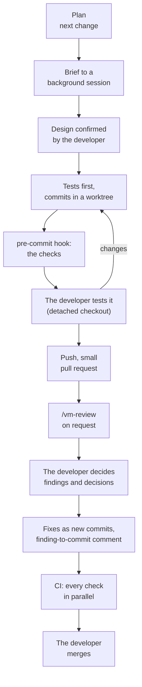

# How this was built

The project was built with Claude Code: one orchestrating session coordinated background sessions
that wrote the code, while the developer chose the scope, decided the design, tested every branch
and merged every pull request. This document describes that way of working and the checks around
it. What the system is and why it is built that way is in the [design document](design.md); the
working rules themselves live in [AGENTS.md](../AGENTS.md), "Working with agent sessions".

## Roles

| Who | Does |
|---|---|
| The developer | Chooses what to build next, confirms each design before code is written, decides every trade-off a review raises, tests each branch by hand, merges. |
| The orchestrating session | Keeps the plan, writes the briefs, launches and follows the sessions, pushes branches, opens pull requests, runs and posts the reviews, maps each finding to its fix. |
| A background session | Works on one change in its own git worktree: confirms the design, writes the tests first, commits, runs the checks, and stops without publishing anything. |

A session never pushes, merges or rewrites what is published. A force push, anything on `master`,
discarding unpushed work and merging always wait for the developer.

## The cycle

1. **Plan.** The orchestrating session keeps a plan of small iterations, one concern per pull
   request, so a person can review each in one sitting. Stacked pull requests split the larger
   features (persistence in five, technician authentication in four).
2. **Brief.** Each session gets a written brief: what exists, what to build, the design questions
   to settle first, the checks, and the rule to stop before publishing. The brief is the only
   context the session has.
3. **Design first.** For anything with a choice in it, the session presents the options with a
   recommendation and waits for the developer.
4. **Tests first, in a worktree.** The session works in its own git worktree with its own test
   databases, so several run in parallel without touching each other or the developer's checkout.
5. **The developer tests.** The main checkout, where the containers, `make`, the IDE and Xdebug
   point, switches to the branch detached, so the session can keep moving it.
6. **Pull request and review.** A tested branch is pushed and its pull request opened. A review
   runs when the developer asks for it.
7. **Fixes are traceable.** Fixes land as new commits, and a comment on the pull request maps each
   finding to its commit; a finding that is declined says why.
8. **CI and merge.** The developer merges once CI is green.

## Quality gates

| Gate | When | What |
|---|---|---|
| Git hooks | Every commit | Branch names, Conventional Commits, and, when code is staged: coding standard, container lint, PHPStan at the max level, deptrac (layers and contexts), PHPUnit and Behat, inside the project's PHP image. |
| CI | Every pull request and push to `master` | The same checks as parallel jobs on GitHub-hosted runners; branch protection requires `All checks passed`. |
| Contract tests | In the suite | One repository contract run against both stores; `OpenApiDocumentTest` keeps `docs/openapi.yaml` and the routes in step; `DomainExceptionStatusTest` makes every domain exception map to a status. |
| Review | On request | `/vm-review` (below). |
| The developer | Every branch | Tries it by hand before it is published, and decides what a review raises. |

## The review skill

`/vm-review` is a project skill (`.claude/skills/vm-review/`) that reviews a pull request or a
range in a headless session. An orchestrator splits the change across lenses (correctness, silent
failures, project rules, tests, design, readability, docs), each a reviewer with its own brief;
verifiers then try to disprove each finding before it is reported. The report ranks findings by
severity, lists at most three decisions for the developer to confirm, and is posted on the pull
request only when the developer says so.

The skill is business-agnostic on purpose: it knows nothing about vending machines, so it reviews
the engineering, not the statement. Its parts have cheap tests (`lens-tests/`, a frontmatter and
path check run by the hooks), and changes to its orchestrator are measured with evals: fixed cases
with planted bugs, graded against earlier iterations.

## Decisions the developer took

A few of the calls that came from the developer rather than from a session, each recorded where it
belongs:

- Bounded contexts from the start, with a small shared kernel (ADR 1).
- A tray read by a query and emptied by a command, so commands return nothing (ADR 7).
- The change maker passed to `select()`, not stored in the aggregate (ADR 9).
- The machine as one MongoDB document, the rest in MySQL (ADR 16), and UUID identities with a
  shared base (ADR 17).
- A lost concurrent update answers 409, and an unmapped domain exception 500.
- The technician's id carried by the service command as the audit trail until domain events exist,
  and a hand-written login on the query bus instead of `json_login` or FOSUserBundle (ADR 18, with
  technician authentication).
- Machine capacities as domain rules checked on restock (ADR 19, with technician authentication).
- Which review findings to fix and which to decline, on every pull request.

## What went wrong, and what changed because of it

- **A pull request was merged before its review fixes.** The fixes landed in the next pull request,
  with a comment on the merged one mapping each finding to its commit.
- **Review decisions went unconfirmed** on three pull requests that were merged quickly. They were
  walked through afterwards, and two of them changed the API (the 500 and 409 rules).
- **Too many decisions per review** (up to twelve) buried the ones that mattered; the skill now
  keeps three, ranked.
- **Background sessions stopped on permission prompts and could not clean their own worktrees.**
  The workflow now gives each new worktree a `.env` from `.env.dist`, tests branches with a
  detached checkout, lets tested branches and review fixes be pushed without a separate approval,
  and widens the project allowlist for local commands only.
- **Parallel stacks collided** (two ADRs numbered 17, two migrations with the same version). The
  branch that merges second renumbers; the rebase brief says so.

## In numbers

About sixty pull requests and four hundred commits, over sixty reviews posted on them, and
seventeen ADRs on `master`; technician authentication adds two more ADRs and brings the suite to
about five hundred PHPUnit tests and twelve Behat scenarios.
